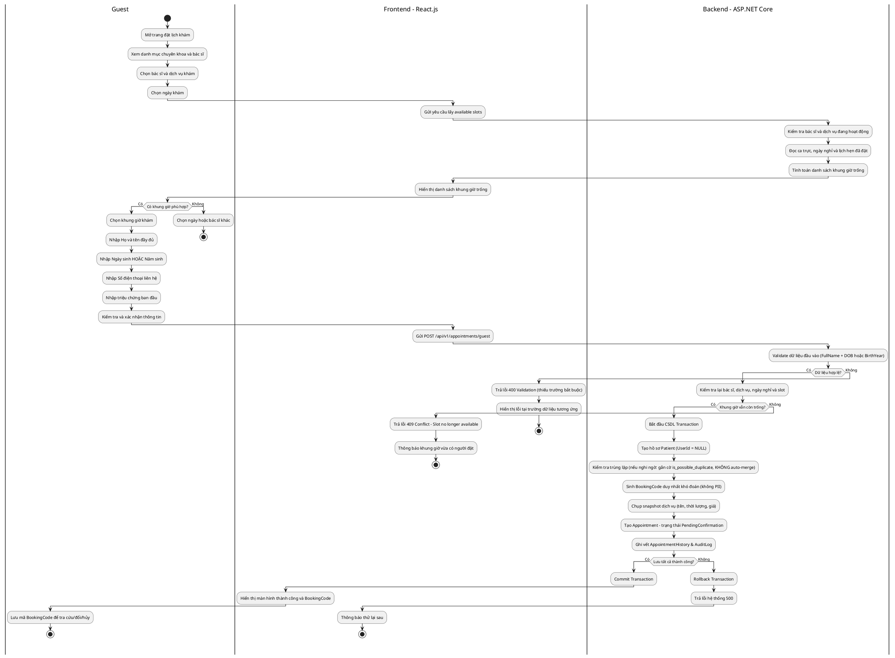
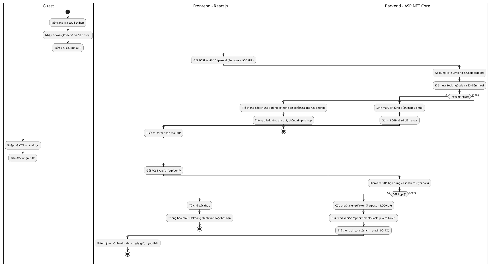
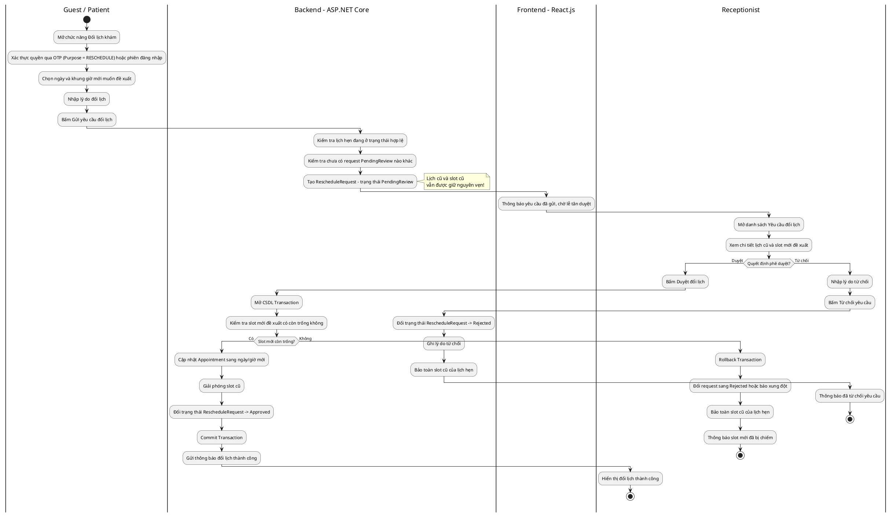
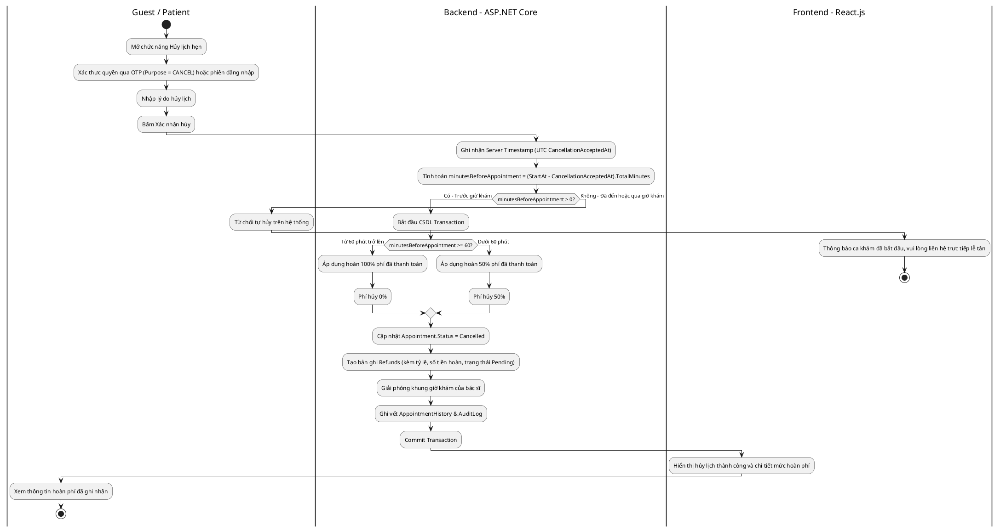
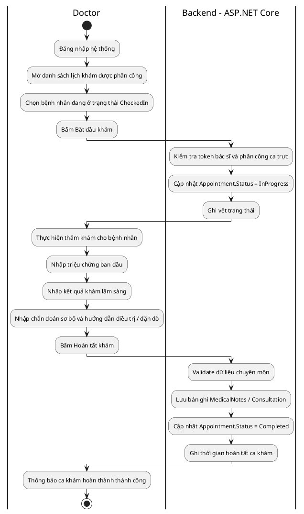

# Clinic Appointment Management System — Activity Diagrams

- **Phiên bản:** 1.2
- **Căn cứ trên:** [docs/SPEC.md](SPEC.md) (SRS Version 1.2 Baseline) và [docs/USE_CASE_SPECIFICATION.md](USE_CASE_SPECIFICATION.md)
- **Ký pháp:** PlantUML Activity Diagram

---

## 1. Activity Diagram – Đặt lịch khám không cần đăng nhập (Guest Booking)

Mô tả luồng đặt lịch công khai từ lúc Guest chọn dịch vụ đến khi nhận mã đặt lịch (`BookingCode`).

---

## 2. Activity Diagram – Tra cứu lịch hẹn bằng BookingCode và OTP

Mô tả luồng Guest tra cứu thông tin lịch hẹn an toàn qua xác thực mã OTP.

---

## 3. Activity Diagram – Quy trình Đổi lịch khám (Reschedule Workflow)

Mô tả quy trình đổi lịch: Bệnh nhân gửi yêu cầu, lễ tân phê duyệt; **slot cũ giữ nguyên cho đến khi duyệt**.

---

## 4. Activity Diagram – Bệnh nhân Hủy lịch & Tính toán Hoàn phí (Cancellation & Refund)

Mô tả quy trình tự hủy lịch: **Không cần lễ tân duyệt**, tính hoàn phí theo mốc 60 phút.

---

## 5. Activity Diagram – Bác sĩ Tiếp nhận & Hoàn tất Ca khám

