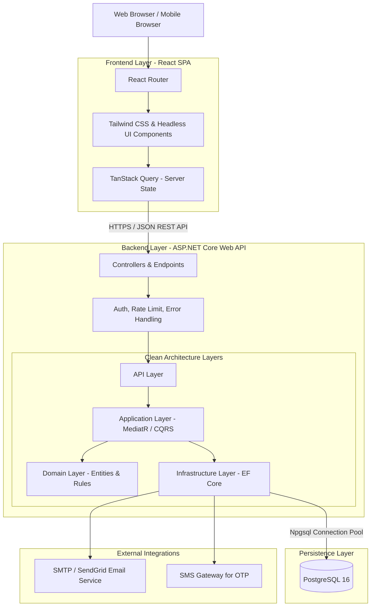

# Architecture Design Document

## 1. Kiến trúc tổng thể (High-Level Architecture)

Hệ thống được thiết kế theo mô hình phân tách hoàn toàn giữa **Frontend (Single Page Application)** và **Backend (RESTful Web API)**, kết hợp cơ sở dữ liệu quan hệ **PostgreSQL**.



---

## 2. Kiến trúc Backend (ASP.NET Core Clean Architecture)

Backend được tổ chức theo triết lý **Clean Architecture (Onion Architecture)** nhằm đảm bảo tính độc lập giữa logic nghiệp vụ và các công nghệ bên ngoài:

```text
backend/
├── src/
│   ├── ClinicAppointment.Domain/              # Lõi nghiệp vụ (Domain Entities, Enums, Value Objects)
│   │   ├── Entities/                          # Appointment, Doctor, Patient, DoctorSchedule...
│   │   ├── Enums/                             # AppointmentStatus, Gender, DayOfWeek...
│   │   ├── Exceptions/                        # DomainValidationException...
│   │   └── ValueObjects/                      # TimeRange, PhoneNumber, EmailAddress...
│   │
│   ├── ClinicAppointment.Application/         # Use Cases & Orchestration
│   │   ├── Common/                            # Interfaces, Behaviors (Validation, Logging)
│   │   ├── Features/                          # Cấu trúc theo Feature (Vertical Slice hoặc CQRS)
│   │   │   ├── Appointments/                  # Commands (Book, Cancel), Queries (GetSlots, GetList)
│   │   │   ├── Doctors/                       # Queries (Search, GetById), Commands
│   │   │   └── Schedules/                     # Queries (GetAvailableSlots)
│   │   └── DTOs/                              # Data Transfer Objects
│   │
│   ├── ClinicAppointment.Infrastructure/      # Chi tiết kỹ thuật & giao tiếp bên ngoài
│   │   ├── Persistence/                       # ApplicationDbContext, Entity Configurations
│   │   ├── Migrations/                        # EF Core Migrations
│   │   ├── Services/                          # EmailSender, SmsSender, TokenGenerator
│   │   └── Repositories/                      # Triển khai Repository / Unit of Work (nếu cần)
│   │
│   └── ClinicAppointment.Api/                 # Presentation Layer
│       ├── Controllers/                       # RESTful API Controllers
│       ├── Middlewares/                       # Global Exception Handling, Request Logging
│       ├── Extensions/                        # ServiceCollection Extensions
│       └── appsettings.json                   # Cấu hình môi trường
│
└── tests/
    ├── ClinicAppointment.Domain.Tests/
    ├── ClinicAppointment.Application.Tests/
    └── ClinicAppointment.Api.IntegrationTests/
```

### Nguyên tắc liên kết giữa các tầng:
1. **Domain Layer:** Tuyệt đối không tham chiếu tầng nào khác. Không phụ thuộc vào EF Core hay ASP.NET Core.
2. **Application Layer:** Chỉ tham chiếu `Domain Layer`. Chứa interfaces (ví dụ `IApplicationDbContext`, `IEmailService`) mà không phụ thuộc vào triển khai cụ thể.
3. **Infrastructure Layer:** Tham chiếu `Application` và `Domain`. Hiện thực hóa các interfaces thông qua EF Core, Npgsql, SMTP client...
4. **API Layer:** Điểm khởi động (Entry Point), cấu hình Dependency Injection (DI) để kết nối `Infrastructure` và `Application`.

---

## 3. Kiến trúc Frontend (React.js Architecture)

Mã nguồn frontend được tổ chức theo mô hình **Feature-Based (Mô-đun hóa theo tính năng)**:

```text
frontend/
├── public/
├── src/
│   ├── assets/               # Hình ảnh, icons, fonts tĩnh
│   ├── components/           # UI components dùng chung (Button, Modal, Input, Table...)
│   ├── features/             # Các tính năng độc lập
│   │   ├── auth/             # Login, Register, Forgot Password
│   │   ├── booking/          # Flow đặt lịch: chọn chuyên khoa, bác sĩ, ngày giờ, thông tin bệnh nhân
│   │   ├── appointments/     # Danh sách lịch hẹn, chi tiết, lịch sử
│   │   ├── doctors/          # Danh bạ bác sĩ, thông tin chi tiết bác sĩ
│   │   ├── reception/        # Quầy tiếp đón: check-in, tìm kiếm mã hẹn, tiếp nhận walk-in
│   │   └── admin/            # Quản trị chuyên khoa, tài khoản, thống kê
│   ├── hooks/                # Custom hooks dùng chung (useDebounce, useAuth...)
│   ├── layouts/              # Layout cho Patient Portal, Doctor Portal, Admin Dashboard
│   ├── services/             # Cấu hình Axios / Fetch client, API base URL, Interceptors
│   ├── types/                # TypeScript interfaces / types dùng chung
│   ├── utils/                # Date formatting, format tiền tệ, validation helpers
│   ├── App.tsx               # Main routing & Provider setup
│   └── main.tsx              # React Root Mounting
├── tailwind.config.js
├── vite.config.ts
└── tsconfig.json
```

### Quản lý trạng thái (State Management):
- **Server State (Dữ liệu từ API):** Sử dụng `TanStack Query (React Query)` để quản lý cache, tự động revalidate, handling loading/error state.
- **Client State (Trạng thái UI toàn cục):** Sử dụng `Zustand` cho trạng thái đăng nhập người dùng (Auth Session) và giỏ đặt lịch (Booking Draft).
- **Form State:** Sử dụng `React Hook Form` kết hợp với `Zod` để validate dữ liệu đầu vào phía client.

---

## 4. Chiến lược xử lý Đồng thời (Concurrency Handling)

Một trong những bài toán quan trọng nhất của hệ thống đặt lịch phòng khám là **ngăn chặn 2 người đặt cùng 1 ca khám của bác sĩ tại 1 thời điểm**:
1. **Database Constraint (Hàng rào cứng):** Tạo unique constraint hoặc exclusion constraint trên PostgreSQL cho cặp `(doctor_id, start_time)` với trạng thái lịch hẹn khác `Cancelled`.
2. **Optimistic Locking:** Sử dụng thuộc tính `xmin` (PostgreSQL row version) hoặc trường `RowVersion` trong Entity Framework Core.
3. **Pessimistic Locking / Transaction:** Khi lưu trữ lịch hẹn, thực hiện trong một Transaction với mức cô lập phù hợp (`ReadCommitted` hoặc `Serializable` khi kiểm tra slot khả dụng và insert lịch hẹn).

