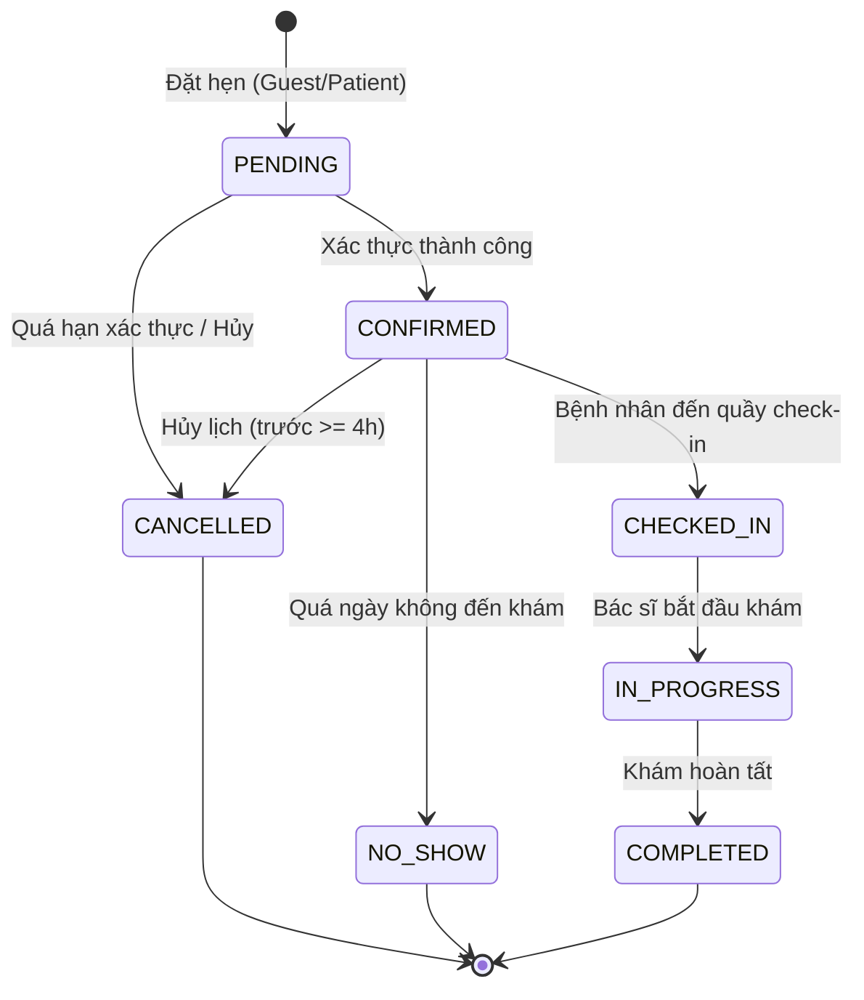

# Business Rules Specification (Quy tắc Nghiệp vụ)

## 1. Quy tắc Thời gian Đặt lịch (Booking Windows)

- **BR-TIME-01 (Thời hạn đặt trước tối đa):** Bệnh nhân chỉ được phép đặt lịch trước tối đa **30 ngày** so với ngày hiện tại.
- **BR-TIME-02 (Thời hạn đặt trước tối thiểu):** Lịch hẹn trực tuyến phải được đặt trước giờ khám thực tế tối thiểu **02 giờ**. Không cho phép đặt lịch cho khung giờ đã qua trong quá khứ hoặc cận giờ khám dưới 2 tiếng (trừ trường hợp lễ tân tạo lịch Walk-in tại quầy).
- **BR-TIME-03 (Giới hạn số lượng lịch hoạt động):** Mỗi số điện thoại / tài khoản bệnh nhân chỉ được phép có tối đa **02 lịch hẹn ở trạng thái Chưa hoàn tất (`PENDING` hoặc `CONFIRMED`)** trong cùng một ngày.

---

## 2. Quy tắc Chia Slot & Chống Trùng Lịch (Slot Calculation & Anti-Collision)

- **BR-SLOT-01 (Định nghĩa Khung giờ khám):**
  - Khung giờ khám của bác sĩ được chia đều theo tham số `slot_duration_minutes` (mặc định: 30 phút).
  - Ví dụ: Ca làm việc từ 08:00 đến 11:30 với slot 30 phút sẽ tạo ra: `08:00 - 08:30`, `08:30 - 09:00`, `09:00 - 09:30`, `09:30 - 10:00`, `10:00 - 10:30`, `10:30 - 11:00`, `11:00 - 11:30`.
- **BR-SLOT-02 (Loại trừ khung giờ không khả dụng):**
  - Khung giờ rơi vào khoảng thời gian Bác sĩ đăng ký nghỉ phép (`doctor_unavailabilities`) sẽ không hiển thị trên giao diện người dùng.
- **BR-SLOT-03 (Chống Trùng Lặp Tuyệt Đối - Zero Double Booking):**
  - Một slot của bác sĩ tại một thời điểm chỉ tiếp nhận duy nhất **01 bệnh nhân**.
  - Kiểm tra trạng thái slot khả dụng tại thời điểm trước khi chốt đơn. Trong lúc ghi nhận dữ liệu vào CSDL, giao dịch phải được thực hiện với cơ chế khóa hoặc kiểm tra Unique Index để đảm bảo tính toàn vẹn (ACID).

---

## 3. Quy tắc Khách vãng lai (Guest Booking Rules)

- **BR-GUEST-01 (Dữ liệu bắt buộc):** Khách vãng lai bắt buộc phải cung cấp đầy đủ:
  - Họ và tên (tối thiểu 2 từ, không chứa ký tự đặc biệt).
  - Số điện thoại hợp lệ (chuẩn số điện thoại di động Việt Nam: 10 chữ số, bắt đầu bằng 03, 05, 07, 08, 09).
  - Ngày sinh (dùng để định danh và phân biệt hồ sơ).
- **BR-GUEST-02 (Xác thực thông tin):**
  - Lịch hẹn của khách vãng lai sau khi tạo có thể ở trạng thái `PENDING` nếu yêu cầu xác nhận qua OTP/Email.
  - Sau khi mã xác nhận được nhập thành công trong vòng 10 phút, lịch hẹn tự động chuyển sang `CONFIRMED`.
  - Nếu sau 10 phút không xác nhận, slot sẽ tự động được giải phóng để người khác có thể đặt.

---

## 4. Ma trận Chuyển trạng thái Lịch hẹn (Lifecycle State Machine)

| Trạng thái hiện tại | Trạng thái mới | Tác nhân cho phép | Điều kiện tiên quyết |
| :--- | :--- | :--- | :--- |
| `PENDING` | `CONFIRMED` | System / Receptionist | Xác thực OTP thành công hoặc Lễ tân duyệt |
| `PENDING` | `CANCELLED` | System / Patient | Hết hạn xác thực OTP hoặc người dùng hủy |
| `CONFIRMED` | `CHECKED_IN` | Receptionist | Bệnh nhân có mặt tại phòng khám vào ngày hẹn |
| `CONFIRMED` | `CANCELLED` | Patient / Staff | Hủy trước giờ khám tối thiểu 04 tiếng |
| `CONFIRMED` | `NO_SHOW` | System / Staff | Hết ngày khám mà bệnh nhân không đến check-in |
| `CHECKED_IN` | `IN_PROGRESS` | Doctor | Bác sĩ gọi bệnh nhân vào phòng khám |
| `IN_PROGRESS` | `COMPLETED` | Doctor | Bác sĩ kết thúc thăm khám và ghi chú tóm tắt |

---

## 5. Chính sách Hủy & Dời lịch (Cancellation & Reschedule Policy)

- **BR-CANCEL-01 (Thời hạn hủy lịch):** Bệnh nhân có thể chủ động hủy lịch trên hệ thống trước giờ khám tối thiểu **04 tiếng**.
- **BR-CANCEL-02 (Hủy gấp qua Hotline):** Trong vòng dưới 04 tiếng, bệnh nhân phải liên hệ trực tiếp lễ tân qua số điện thoại hỗ trợ của phòng khám để xử lý.
- **BR-CANCEL-03 (Chính sách xử phạt No-Show):** Tài khoản hoặc số điện thoại có từ **03 lần No-Show trong vòng 30 ngày** sẽ bị tạm khóa tính năng đặt lịch trực tuyến trong 14 ngày.

