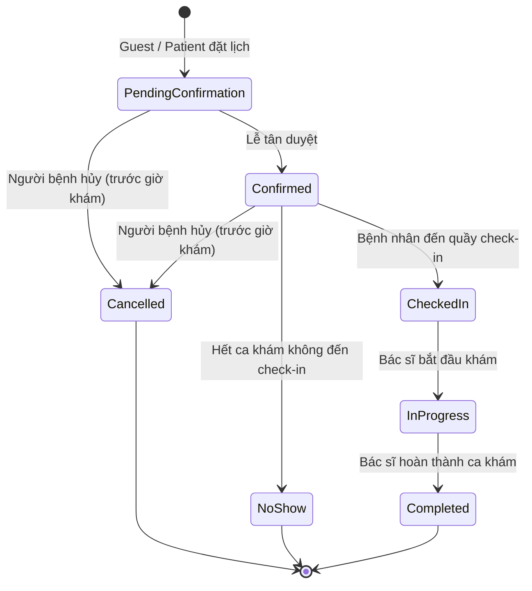
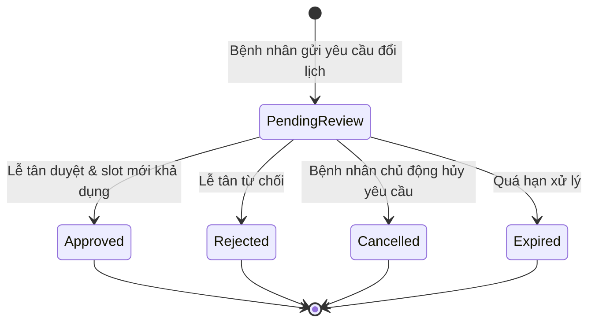

# Business Rules Specification (Quy tắc Nghiệp vụ)
> **Đồng bộ với:** [docs/SPEC.md](SPEC.md) (Phiên bản SRS 1.2 Baseline)

---

## 1. Quy tắc Thời gian & Khung giờ Khám (Booking Windows & Slots)

- **BR-TIME-01 (Thời hạn đặt trước):** Lịch hẹn khám chỉ được đặt trước tối đa theo cấu hình phòng khám (mặc định 30 ngày) và không được đặt trong quá khứ hoặc trong ngày nghỉ / giờ bận của bác sĩ.
- **BR-TIME-02 (Thời lượng ca khám & Sinh slot):**
  - Khung giờ khám của bác sĩ được sinh tự động dựa trên thời lượng dịch vụ hoặc ca trực định kỳ (`slot_duration_minutes`).
  - Hệ thống tự động loại trừ các khoảng thời gian nghỉ phép / công tác / bận đột xuất của bác sĩ (`doctor_unavailabilities`).
- **BR-TIME-03 (Chống Trùng Lặp Tuyệt Đối - Zero Double Booking):**
  - Một slot của bác sĩ tại một thời điểm chỉ tiếp nhận duy nhất **01 bệnh nhân**.
  - Kiểm tra tính khả dụng của slot ngay tại thời điểm ghi dữ liệu (Atomic check trong CSDL Transaction kết hợp Unique Constraint). Hai request gửi đồng thời cho cùng một bác sĩ trong cùng một slot không bao giờ được phép cùng thành công.

---

## 2. Quy tắc Hồ sơ Bệnh nhân & Quản lý Định danh (Patient Identity & Duplicate Prevention)

- **BR-ID-01 (Hồ sơ Patient độc lập User):**
  - Bệnh nhân vãng lai có hồ sơ `Patient` với `UserId = NULL`.
  - Không tự động tạo tài khoản `User` khi đặt lịch vãng lai.
- **BR-ID-02 (Thông tin nhận diện bắt buộc):**
  - Mỗi hồ sơ bắt buộc phải có `FullName` (Họ và tên).
  - Bắt buộc có ít nhất một trong hai trường: `DateOfBirth` (ngày sinh) hoặc `BirthYear` (năm sinh).
  - Số điện thoại liên hệ phải được lưu trữ; số điện thoại dùng để nhận mã OTP phải được xác minh.
- **BR-ID-03 (Quy tắc Đối sánh & Chống trùng lặp):**
  - Chuẩn hóa định danh (loại bỏ ký tự phân cách, chuẩn hóa chữ hoa/thường).
  - Trùng khớp chính xác (Exact match) theo định danh mạnh đã xác minh (CCCD, Hộ chiếu, BHYT, PID) là tín hiệu mạnh nhất; nếu có xung đột phải chuyển kiểm tra thủ công (Manual review).
  - Trùng khớp Họ tên + Ngày sinh/Năm sinh (`FullName` + `DOB`/`BirthYear`) **chỉ tạo ra hồ sơ ứng viên nghi trùng (Candidate Duplicate)**; **tuyệt đối không tự động gộp hồ sơ (No Auto-merge)**.
  - Nếu không có match chắc chắn, tạo hồ sơ `Patient` mới và có thể gắn cờ nghi ngờ trùng lặp.
  - Chỉ nhân viên được phân quyền mới được gộp hồ sơ; bắt buộc ghi nhận `Actor`, `Timestamp`, `Reason` và `Audit Trail`.
- **BR-ID-04 (Bảo vệ Định danh Nhạy cảm):**
  - CCCD, Hộ chiếu, Mã BHYT, PID bắt buộc phải mã hóa khi lưu trữ trong CSDL và che một phần (Masking) khi hiển thị.
  - Sử dụng mã băm có khóa bí mật (`Keyed HMAC`) của giá trị chuẩn hóa để tra cứu chính xác (`Exact Lookup`). Tuyệt đối không dùng Plain SHA-256 cho định danh có không gian giá trị dễ đoán.

---

## 3. Quy tắc Đặt lịch & Mã lịch hẹn (Guest Booking & Booking Code)

- **BR-BOOK-01 (Đặt lịch vãng lai không tài khoản):** Guest được phép đặt lịch trực tiếp mà không cần JWT token hoặc phiên đăng nhập.
- **BR-BOOK-02 (Snapshot Dịch vụ):** Tại thời điểm đặt lịch, hệ thống bắt buộc chụp lại bản ghi (Snapshot) gồm: Tên dịch vụ, Thời lượng dịch vụ, và Giá dịch vụ niêm yết lúc đặt (`ServiceSnapshot`). Mọi biến động giá sau đó không làm thay đổi giá trị đã chốt trên lịch hẹn.
- **BR-BOOK-03 (Mã Đặt lịch - BookingCode):**
  - Hệ thống tự động sinh `BookingCode` duy nhất trên toàn hệ thống, khó đoán và tuyệt đối không chứa thông tin định danh cá nhân (PII).
  - Định dạng chuẩn: `APT-YYYYMMDD-XXXX` (với `XXXX` là chuỗi ngẫu nhiên không trùng lặp).

---

## 4. Quy tắc Xác thực OTP (OTP Verification Rules)

- **BR-OTP-01 (Mục đích OTP):**
  - Mã OTP chỉ áp dụng cho 3 mục đích cụ thể: Tra cứu (`LOOKUP`), Đổi lịch (`RESCHEDULE`), Hủy lịch (`CANCEL`).
  - Booking ban đầu của Guest không bắt buộc OTP (theo Baseline TBD-02).
- **BR-OTP-02 (Bảo vệ Mã OTP):**
  - Mã OTP là dùng 1 lần (Single-use), gắn chặt với số điện thoại, mã booking, mục đích (`Purpose`) và phiên thử thách (`Challenge`).
  - Có thời hạn hiệu lực (Expiry, mặc định 5 phút), giới hạn số lần nhập sai (tối đa 5 lần) và giới hạn tần suất gửi lại (Resend cooldown tối thiểu 60 giây).
- **BR-OTP-03 (Phạm vi Quyền hạn tạm thời):**
  - Xác thực OTP thành công chỉ cấp quyền tạm thời giới hạn theo đúng mã booking và mục đích đã chọn.
  - Tra cứu bằng OTP không hiển thị toàn bộ bệnh án chi tiết hay định danh đầy đủ ra ngoài màn hình công khai.

---

## 5. Quy tắc Đổi lịch khám (Reschedule Workflow)

- **BR-RESCHED-01 (Yêu cầu Đổi lịch):**
  - Bệnh nhân (Guest qua OTP hoặc Patient đăng nhập) có thể gửi yêu cầu đề xuất ngày/giờ mới cho lịch hẹn đang có hiệu lực.
  - Trạng thái yêu cầu: `PendingReview` -> `Approved` / `Rejected` / `Cancelled` / `Expired`.
  - Mỗi lịch hẹn tại một thời điểm chỉ được phép có tối đa một yêu cầu đổi lịch ở trạng thái `PendingReview`.
- **BR-RESCHED-02 (Bảo toàn Slot cũ):**
  - **Lịch cũ và slot cũ vẫn được giữ nguyên vẹn** và tiếp tục chiếm giữ slot cho đến khi yêu cầu đổi lịch được lễ tân phê duyệt thành công.
- **BR-RESCHED-03 (Phê duyệt của Lễ tân):**
  - Lễ tân có quyền duyệt (`Approved`) hoặc từ chối (`Rejected`), bắt buộc ghi nhận lý do, người xử lý và thời điểm xử lý.
  - Khi duyệt, Backend bắt buộc kiểm tra lại tính khả dụng của slot mới trong Transaction. Nếu slot mới không còn trống, hệ thống không cho phép đổi và giữ nguyên lịch cũ.

---

## 6. Chính sách Hủy lịch & Hoàn phí (Cancellation & Refund Policy)

- **BR-CANCEL-01 (Quyền tự hủy):**
  - Guest (sau OTP) hoặc Patient đăng nhập có thể chủ động hủy lịch trước giờ khám bắt đầu.
  - **Không cần nhân viên lễ tân duyệt** yêu cầu hủy do bệnh nhân gửi.
- **BR-CANCEL-02 (Thời điểm hủy):**
  - Thời điểm hủy được xác định theo dấu thời gian máy chủ (Server timestamp - UTC `CancellationAcceptedAt`). Tuyệt đối không dùng đồng hồ của Client.
- **BR-CANCEL-03 (Công thức Hoàn phí Chuẩn):**
  $$\text{minutesBeforeAppointment} = (\text{StartAt} - \text{CancellationAcceptedAt}).\text{TotalMinutes}$$
  
  | Mốc thời gian | Phí hủy (trên phí dịch vụ) | Tỷ lệ hoàn (trên số tiền đã thanh toán) |
  | :--- | :--- | :--- |
  | $\text{minutesBeforeAppointment} \ge 60$ | **0%** | **100%** |
  | $0 < \text{minutesBeforeAppointment} < 60$ | **50%** | **50%** |
  | $\text{minutesBeforeAppointment} \le 0$ | *Không áp dụng tự hủy* | *Không áp dụng tự hoàn tiền* |

- **BR-CANCEL-04 (Nguyên tắc tính toán):**
  - Đúng mốc 60 phút được tính thuộc nhóm **hoàn 100%**.
  - Toàn bộ phép tính tỷ lệ và số tiền hoàn phí phải do **Backend quyết định**, không nhận tham số tỷ lệ/tiền từ Frontend.
  - Số tiền hoàn dự kiến: $\text{ExpectedRefundAmount} = \text{PaidServiceAmount} \times \text{RefundRate}$.
  - Nếu lịch hẹn chưa thanh toán: $\text{ExpectedRefundAmount} = 0$.
  - Sau giờ hẹn bắt đầu, bệnh nhân không thể tự hủy; xử lý qua Lễ tân hoặc hệ thống ghi nhận `NoShow`.

---

## 7. Máy Trạng thái Vòng đời Lịch hẹn (State Machine Transitions)

### 7.1 Lịch hẹn (Appointment Status)
- `PendingConfirmation`: Chờ lễ tân xác nhận sau khi đặt.
- `Confirmed`: Đã được lễ tân xác nhận.
- `CheckedIn`: Bệnh nhân đã có mặt tại quầy check-in.
- `InProgress`: Bác sĩ đang tiến hành khám.
- `Completed`: Bác sĩ hoàn tất ca khám và ghi nhận kết luận.
- `Cancelled`: Bị hủy bởi người bệnh hoặc phòng khám.
- `NoShow`: Bệnh nhân không đến khám.

### 7.2 Yêu cầu Đổi lịch (Reschedule Request Status)

### 7.3 Hoàn tiền (Refund Status)
- `NotApplicable`: Không hoàn phí (chưa đóng phí hoặc phí hủy 100%).
- `Pending`: Đã tạo bản ghi hoàn phí, chờ xử lý.
- `Processing`: Đang trong tiến trình chuyển khoản hoàn tiền.
- `Succeeded`: Hoàn tiền thành công.
- `Failed`: Hoàn tiền thất bại (cần đối soát kỹ thuật).
