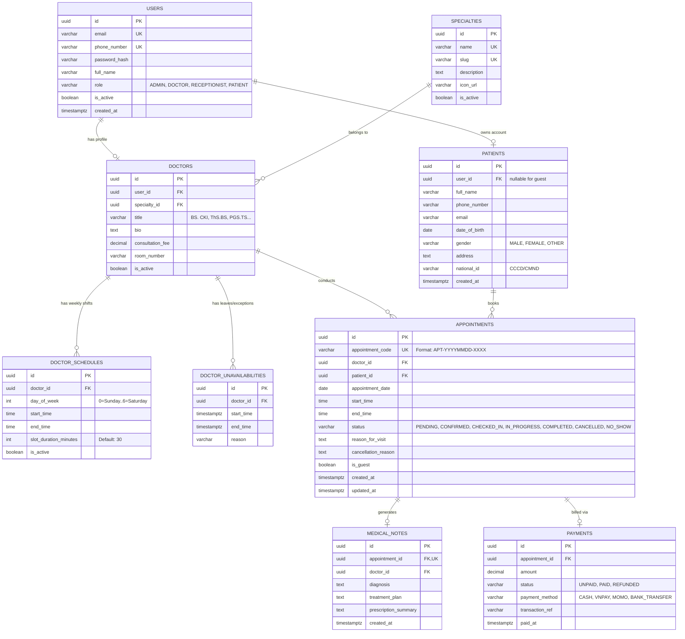

# Database Design Specification

## 1. Tổng quan thiết kế CSDL (Overview)

Hệ thống sử dụng hệ quản trị cơ sở dữ liệu quan hệ **PostgreSQL 16+**.
- **Quy chuẩn đặt tên trong DB:** Chữ thường nối gạch dưới (`snake_case`) cho bảng và cột.
- **Khóa chính:** `UUID` (hoặc `BIGSERIAL` / `BIGINT GENERATED ALWAYS AS IDENTITY`). Khuyến nghị dùng `UUID` cho các bảng thực thể người dùng, lịch hẹn để tránh lộ số lượng dữ liệu và hỗ trợ distributed generation.
- **Thời gian:** Toàn bộ cột thời gian sử dụng kiểu `timestamptz` (Timestamp with Time Zone - chuẩn UTC).
- **Xóa mềm (Soft Delete):** Áp dụng cột `is_deleted (boolean)` và `deleted_at (timestamptz)` trên các bảng nghiệp vụ quan trọng.

---

## 2. Sơ đồ thực thể quan hệ (ERD - Entity Relationship Diagram)



---

## 3. Chi tiết các bảng dữ liệu (Data Dictionary)

### 3.1 Bảng `users` (Tài khoản người dùng)
| Tên cột | Kiểu dữ liệu | Ràng buộc | Mô tả |
| :--- | :--- | :--- | :--- |
| `id` | `uuid` | PK, Default `gen_random_uuid()` | Định danh người dùng |
| `email` | `varchar(150)` | UNIQUE, Nullable | Email đăng nhập |
| `phone_number` | `varchar(20)` | UNIQUE, Nullable | Số điện thoại liên hệ/đăng nhập |
| `password_hash` | `text` | NOT NULL | Mật khẩu băm (BCrypt / Argon2) |
| `full_name` | `varchar(100)` | NOT NULL | Họ và tên |
| `role` | `varchar(20)` | NOT NULL | Vai trò: `ADMIN`, `DOCTOR`, `RECEPTIONIST`, `PATIENT` |
| `is_active` | `boolean` | NOT NULL, Default `true` | Trạng thái kích hoạt tài khoản |
| `created_at` | `timestamptz` | NOT NULL, Default `now()` | Thời điểm tạo |
| `updated_at` | `timestamptz` | Nullable | Thời điểm cập nhật cuối |

### 3.2 Bảng `specialties` (Chuyên khoa khám bệnh)
| Tên cột | Kiểu dữ liệu | Ràng buộc | Mô tả |
| :--- | :--- | :--- | :--- |
| `id` | `uuid` | PK | Định danh chuyên khoa |
| `name` | `varchar(100)` | UNIQUE, NOT NULL | Tên chuyên khoa (Tim mạch, Nhi khoa...) |
| `slug` | `varchar(120)` | UNIQUE, NOT NULL | URL thân thiện (`tim-mach`, `nhi-khoa`) |
| `description` | `text` | Nullable | Giới thiệu chuyên khoa |
| `icon_url` | `varchar(255)` | Nullable | Đường dẫn icon minh họa |
| `is_active` | `boolean` | Default `true` | Đang hoạt động hay tạm ẩn |

### 3.3 Bảng `doctors` (Hồ sơ bác sĩ)
| Tên cột | Kiểu dữ liệu | Ràng buộc | Mô tả |
| :--- | :--- | :--- | :--- |
| `id` | `uuid` | PK | Định danh hồ sơ bác sĩ |
| `user_id` | `uuid` | FK -> `users.id`, UNIQUE | Liên kết tài khoản đăng nhập |
| `specialty_id` | `uuid` | FK -> `specialties.id` | Chuyên khoa trực thuộc |
| `title` | `varchar(50)` | Nullable | Học hàm/học vị (BS.CKI, ThS, TS...) |
| `bio` | `text` | Nullable | Giới thiệu quá trình công tác |
| `consultation_fee` | `numeric(12,2)`| NOT NULL, Default 0 | Giá khám tiêu chuẩn (VND) |
| `room_number` | `varchar(20)` | Nullable | Phòng làm việc (P.102, P.205...) |
| `is_active` | `boolean` | Default `true` | Đang nhận lịch khám hay tạm dừng |

### 3.4 Bảng `patients` (Hồ sơ bệnh nhân)
| Tên cột | Kiểu dữ liệu | Ràng buộc | Mô tả |
| :--- | :--- | :--- | :--- |
| `id` | `uuid` | PK | Định danh bệnh nhân |
| `user_id` | `uuid` | FK -> `users.id`, Nullable | Null nếu là khách vãng lai (Guest) |
| `full_name` | `varchar(100)` | NOT NULL | Họ tên đầy đủ của người khám |
| `phone_number` | `varchar(20)` | NOT NULL | Số điện thoại nhận tin nhắn xác nhận |
| `email` | `varchar(150)` | Nullable | Email nhận phiếu hẹn |
| `date_of_birth` | `date` | Nullable | Ngày tháng năm sinh |
| `gender` | `varchar(10)` | Nullable | `MALE`, `FEMALE`, `OTHER` |
| `address` | `text` | Nullable | Địa chỉ liên lạc |
| `national_id` | `varchar(20)` | Nullable | Số CCCD/Hộ chiếu |
| `created_at` | `timestamptz` | NOT NULL, Default `now()` | Thời gian tạo hồ sơ |

### 3.5 Bảng `doctor_schedules` (Khung giờ làm việc định kỳ)
| Tên cột | Kiểu dữ liệu | Ràng buộc | Mô tả |
| :--- | :--- | :--- | :--- |
| `id` | `uuid` | PK | Định danh cấu hình ca khám |
| `doctor_id` | `uuid` | FK -> `doctors.id` | Bác sĩ |
| `day_of_week` | `smallint` | NOT NULL (0-6) | Thứ trong tuần (0: Chủ Nhật, 1: Thứ Hai...) |
| `start_time` | `time` | NOT NULL | Giờ bắt đầu ca làm việc (VD: `08:00:00`) |
| `end_time` | `time` | NOT NULL | Giờ kết thúc ca làm việc (VD: `12:00:00`) |
| `slot_duration_minutes` | `int` | NOT NULL, Default 30 | Độ dài mỗi ca khám (phút) |
| `is_active` | `boolean` | Default `true` | Đang áp dụng hay tạm ngừng |

### 3.6 Bảng `appointments` (Lịch hẹn khám)
| Tên cột | Kiểu dữ liệu | Ràng buộc | Mô tả |
| :--- | :--- | :--- | :--- |
| `id` | `uuid` | PK | Định danh lịch hẹn |
| `appointment_code` | `varchar(30)` | UNIQUE, NOT NULL | Mã tra cứu lịch (VD: `APT-20261113-A8F2`) |
| `doctor_id` | `uuid` | FK -> `doctors.id`, NOT NULL | Bác sĩ phụ trách |
| `patient_id` | `uuid` | FK -> `patients.id`, NOT NULL | Bệnh nhân đặt lịch |
| `appointment_date`| `date` | NOT NULL | Ngày hẹn khám |
| `start_time` | `time` | NOT NULL | Giờ bắt đầu slot khám |
| `end_time` | `time` | NOT NULL | Giờ kết thúc slot khám |
| `status` | `varchar(20)` | NOT NULL | Trạng thái vòng đời lịch hẹn |
| `reason_for_visit` | `text` | Nullable | Triệu chứng / Lý do khám bệnh |
| `cancellation_reason` | `text` | Nullable | Lý do nếu lịch bị hủy |
| `is_guest` | `boolean` | NOT NULL, Default `false` | Đặt lịch theo diện khách vãng lai |
| `created_at` | `timestamptz` | NOT NULL, Default `now()` | Thời gian tạo lịch |
| `updated_at` | `timestamptz` | Nullable | Thời gian cập nhật |

---

## 4. Ràng buộc toàn vẹn & Chỉ mục tối ưu (Indexes & Constraints)

1. **Ngăn chặn Double-Booking tại tầng Database (Partial Index / Exclusion):**
   ```sql
   -- Đảm bảo một bác sĩ không thể có 2 lịch hẹn trùng giờ trong cùng một ngày nếu lịch đó chưa bị hủy
   CREATE UNIQUE INDEX idx_unique_doctor_active_slot 
   ON appointments (doctor_id, appointment_date, start_time) 
   WHERE status NOT IN ('CANCELLED', 'NO_SHOW');
   ```

2. **Chỉ mục tìm kiếm nhanh:**
   ```sql
   -- Tra cứu lịch hẹn theo số điện thoại bệnh nhân
   CREATE INDEX idx_patients_phone ON patients (phone_number);
   
   -- Tra cứu lịch theo ngày và bác sĩ (cho Doctor Workspace & Reception Check-in)
   CREATE INDEX idx_appointments_doctor_date ON appointments (doctor_id, appointment_date);
   CREATE INDEX idx_appointments_date_status ON appointments (appointment_date, status);
   CREATE INDEX idx_appointments_code ON appointments (appointment_code);
   ```

