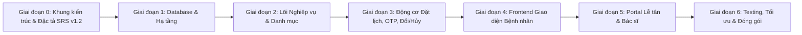

# Development Plan & Implementation Roadmap

> **Đồng bộ với:** [docs/SPEC.md](SPEC.md) (Phiên bản SRS 1.2 Baseline)

---

## 1. Lộ trình triển khai tổng thể (Overview Roadmap)

Dự án được chia thành 6 giai đoạn phát triển rõ ràng với các mục tiêu cụ thể và tiêu chí nghiệm thu chặt chẽ:

---

## 2. Chi tiết các giai đoạn thực hiện

### Giai đoạn 0: Khung kiến trúc & Đặc tả SRS v1.2 (Hoàn thành)
- [x] Khởi tạo bộ khung thư mục chuẩn mực (`docs/`, `planning/`, `.agents/`).
- [x] Soạn thảo và đồng bộ toàn bộ tài liệu đặc tả theo SRS v1.2 Baseline: SRS, Kiến trúc hệ thống, Thiết kế CSDL PostgreSQL, Đặc tả API RESTful, Quy tắc nghiệp vụ, Chiến lược bảo mật và kiểm thử, Use Case & Activity Diagrams.
- [x] Định hình các quyết định kiến trúc cốt lõi (ADR 0001, 0002, 0003).

### Giai đoạn 1: Database & Hạ tầng Cốt lõi
- [ ] Khởi tạo solution .NET 8 với cấu trúc Clean Architecture (`Domain`, `Application`, `Infrastructure`, `Api`).
- [ ] Thiết lập kết nối PostgreSQL thông qua `Npgsql.EntityFrameworkCore.PostgreSQL`.
- [ ] Xây dựng Entity Configurations theo `docs/DATABASE_DESIGN.md`:
  - `Patient` độc lập `User` (cho phép `UserId = NULL`), check constraint `date_of_birth` hoặc `birth_year`.
  - Các trường mã hóa PII và mã băm `Keyed HMAC`.
  - Bảng `services`, `reschedule_requests`, `refunds`, `otp_challenges`.
  - Partial unique indexes chống double-booking (`status NOT IN ('Cancelled', 'NoShow')`) và single pending reschedule.
- [ ] Viết Data Seeder: chuyên khoa, dịch vụ, dữ liệu bác sĩ, ca trực mẫu, tài khoản Admin mặc định.
- [ ] Cấu hình Docker Compose cho PostgreSQL phục vụ phát triển cục bộ.

### Giai đoạn 2: Lõi Nghiệp vụ & Danh mục
- [ ] Triển khai Module Authentication (JWT, Refresh Token, Phân quyền RBAC).
- [ ] Triển khai API Quản lý Chuyên khoa (`Specialties`) và Dịch vụ (`Services`) (FR-001, FR-002, FR-004).
- [ ] Triển khai API Quản lý Bác sĩ (`Doctors`) và Hồ sơ công khai (FR-003).
- [ ] Xây dựng thuật toán tính toán Khung giờ trống (`CalculateAvailableSlots`) dựa trên ca trực, ngày nghỉ và lịch đã hẹn.

### Giai đoạn 3: Động cơ Đặt lịch, OTP, Đổi lịch & Hủy lịch
- [ ] Xây dựng luồng Đặt lịch cho Khách vãng lai (`POST /api/v1/appointments/guest`) với mã `BookingCode` duy nhất và Service Snapshot.
- [ ] Áp dụng cơ chế khóa chống trùng lặp slot (PostgreSQL Unique Index + Transaction).
- [ ] Triển khai cơ chế cấp và xác thực OTP dùng một lần theo mục đích (`LOOKUP`, `RESCHEDULE`, `CANCEL`).
- [ ] Triển khai quy trình Đổi lịch: Bệnh nhân gửi yêu cầu (`PendingReview`, giữ nguyên slot cũ), Lễ tân duyệt trong transaction kiểm tra slot mới.
- [ ] Triển khai luồng Tự Hủy lịch & Tính toán Hoàn phí theo mốc 60 phút (Server Timestamp UTC; $\ge 60$m hoàn 100%, $< 60$m hoàn 50%).
- [ ] Triển khai phát hiện hồ sơ nghi trùng lặp (Strictly No Auto-merge) và quy trình gộp hồ sơ có audit.
- [ ] Viết Integration Test kiểm tra tải đồng thời (Concurrency Test).

### Giai đoạn 4: Giao diện Người dùng Bệnh nhân (Frontend Client)
- [ ] Khởi tạo dự án React (Vite + TypeScript + Tailwind CSS).
- [ ] Cấu hình Layout, Theme, Router, Axios Client, TanStack Query.
- [ ] Xây dựng Booking Wizard: Chọn Chuyên khoa -> Chọn Bác sĩ/Dịch vụ -> Chọn Khung giờ -> Điền thông tin (Họ tên, Ngày sinh hoặc Năm sinh, SĐT).
- [ ] Xây dựng màn hình Tra cứu lịch hẹn bảo mật bằng mã `BookingCode` và mã OTP.
- [ ] Xây dựng Dialog Đổi lịch khám và Dialog Hủy lịch (hiển thị chi tiết tỷ lệ và số tiền hoàn phí).

### Giai đoạn 5: Cổng làm việc Lễ tân & Bác sĩ (Staff & Doctor Portals)
- [ ] **Lễ tân (Receptionist):**
  - Màn hình hàng đợi khám trong ngày.
  - Chức năng duyệt lịch hẹn mới (`PendingConfirmation` -> `Confirmed`).
  - Chức năng check-in một chạm khi bệnh nhân có mặt (`Confirmed` -> `CheckedIn`).
  - Màn hình rà soát và phê duyệt yêu cầu đổi lịch (`Approve` / `Reject`).
  - Màn hình quản lý và gộp hồ sơ bệnh nhân nghi trùng lặp.
- [ ] **Bác sĩ (Doctor):**
  - Danh sách ca khám trong ngày được phân công.
  - Bắt đầu ca khám (`CheckedIn` -> `InProgress`).
  - Ghi nhận triệu chứng, khám lâm sàng, chẩn đoán sơ bộ, dặn dò và hoàn tất ca khám (`InProgress` -> `Completed`).
- [ ] **Quản trị (Admin):** Màn hình bảng điều khiển thống kê và nhật ký kiểm toán (Audit Log).

### Giai đoạn 6: Testing, Tối ưu hóa & Đóng gói Triển khai
- [ ] Thực hiện kiểm thử toàn diện E2E với Playwright.
- [ ] Tối ưu hóa truy vấn CSDL, kiểm tra hiệu năng các index HMAC.
- [ ] Đóng gói Dockerfile cho Backend và Frontend.
- [ ] Thiết lập GitHub Actions CI/CD pipeline tự động build và chạy test.
