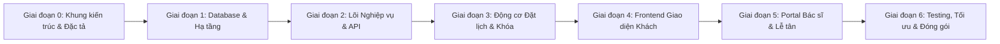

# Development Plan & Implementation Roadmap

## 1. Lộ trình triển khai tổng thể (Overview Roadmap)

Dự án được chia thành 6 giai đoạn phát triển rõ ràng với các mục tiêu cụ thể và tiêu chí nghiệm thu chặt chẽ:

---

## 2. Chi tiết các giai đoạn thực hiện

### Giai đoạn 0: Khung kiến trúc & Đặc tả (Hoàn thành)
- [x] Khởi tạo bộ khung thư mục chuẩn mực (`docs/`, `planning/`, `.agents/`).
- [x] Soạn thảo toàn bộ tài liệu đặc tả: SRS, Kiến trúc hệ thống, Thiết kế CSDL PostgreSQL, Đặc tả API RESTful, Quy tắc nghiệp vụ, Chiến lược bảo mật và kiểm thử.
- [x] Định hình các quyết định kiến trúc cốt lõi (ADR 0001, 0002, 0003).

### Giai đoạn 1: Database & Hạ tầng Cốt lõi
- [ ] Khởi tạo solution .NET 8 với cấu trúc Clean Architecture (`Domain`, `Application`, `Infrastructure`, `Api`).
- [ ] Thiết lập kết nối PostgreSQL thông qua `Npgsql.EntityFrameworkCore.PostgreSQL`.
- [ ] Xây dựng Entity Configurations, chạy migration đầu tiên tạo schema.
- [ ] Viết Data Seeder: chuyên khoa mẫu, dữ liệu bác sĩ, tài khoản Admin mặc định.
- [ ] Cấu hình Docker Compose cho PostgreSQL phục vụ phát triển cục bộ.

### Giai đoạn 2: Lõi Nghiệp vụ & API Quản lý
- [ ] Triển khai Module Authentication (JWT, Refresh Token, Phân quyền RBAC).
- [ ] Triển khai API Quản lý Chuyên khoa (`Specialties`).
- [ ] Triển khai API Quản lý Bác sĩ (`Doctors`) và Hồ sơ cá nhân.
- [ ] Xây dựng thuật toán tính toán Khung giờ trống (`CalculateAvailableSlots`) dựa trên lịch tuần và ngoại lệ nghỉ phép.

### Giai đoạn 3: Động cơ Đặt lịch & Chống Trùng lặp (Core Booking Engine)
- [ ] Xây dựng API Đặt lịch cho bệnh nhân đăng ký (`POST /api/v1/appointments`).
- [ ] Xây dựng luồng Đặt lịch cho Khách vãng lai (`POST /api/v1/appointments/guest`).
- [ ] Áp dụng cơ chế khóa chống trùng lặp slot (PostgreSQL Unique Index + Transaction).
- [ ] Triển khai tích hợp gửi Email xác nhận thông tin phiếu hẹn.
- [ ] Viết Integration Test kiểm tra tải đồng thời (Concurrency Test).

### Giai đoạn 4: Giao diện Người dùng Bệnh nhân (Frontend Client)
- [ ] Khởi tạo dự án React (Vite + TypeScript + Tailwind CSS).
- [ ] Cấu hình Layout, Theme, Router, Axios Client, TanStack Query.
- [ ] Xây dựng Booking Wizard 4 bước: Chọn Chuyên khoa -> Chọn Bác sĩ -> Chọn Giờ khám -> Điền thông tin.
- [ ] Xây dựng trang Tra cứu lịch hẹn bằng mã phiếu hẹn và số điện thoại.
- [ ] Xây dựng trang Lịch sử khám cho bệnh nhân có tài khoản.

### Giai đoạn 5: Cổng làm việc Lễ tân & Bác sĩ (Staff & Doctor Portals)
- [ ] **Lễ tân (Receptionist):** Màn hình tiếp đón, tra cứu nhanh, nút Check-in một chạm, tạo lịch hẹn trực tiếp (Walk-in).
- [ ] **Bác sĩ (Doctor):** Màn hình hàng đợi khám bệnh trong ngày, bắt đầu khám, hoàn tất và ghi chú chẩn đoán.
- [ ] **Quản trị (Admin):** Màn hình thống kê số lượng đặt lịch, quản lý danh sách bác sĩ và ca làm việc.

### Giai đoạn 6: Testing, Tối ưu hóa & Đóng gói Triển khai
- [ ] Thực hiện kiểm thử toàn diện E2E với Playwright.
- [ ] Tối ưu hóa truy vấn CSDL, bổ sung Index cho các câu truy vấn chậm (Slow queries).
- [ ] Đóng gói Dockerfile cho Backend và Frontend.
- [ ] Thiết lập GitHub Actions CI/CD pipeline tự động build và chạy test.

