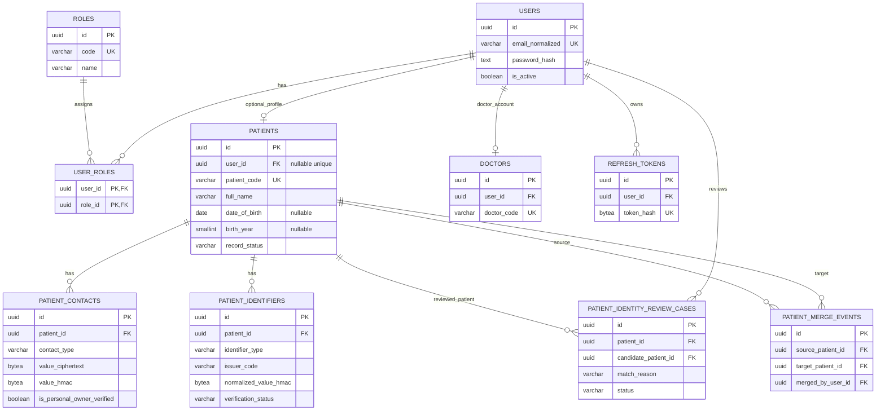
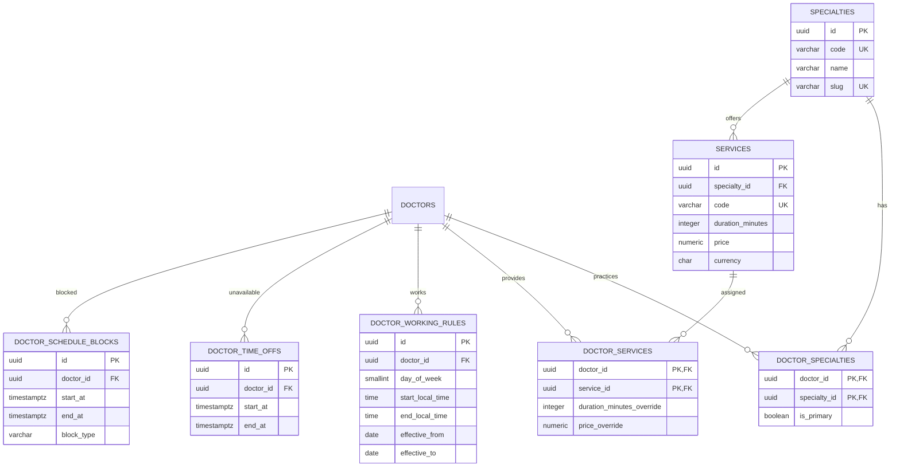
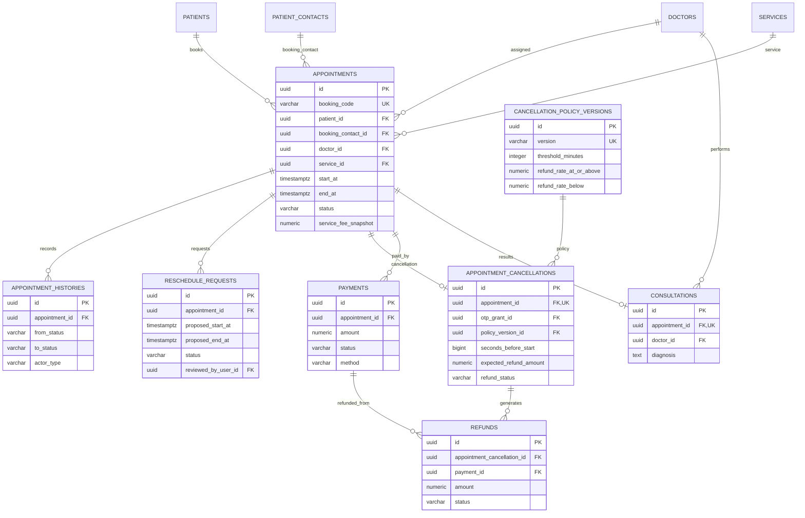
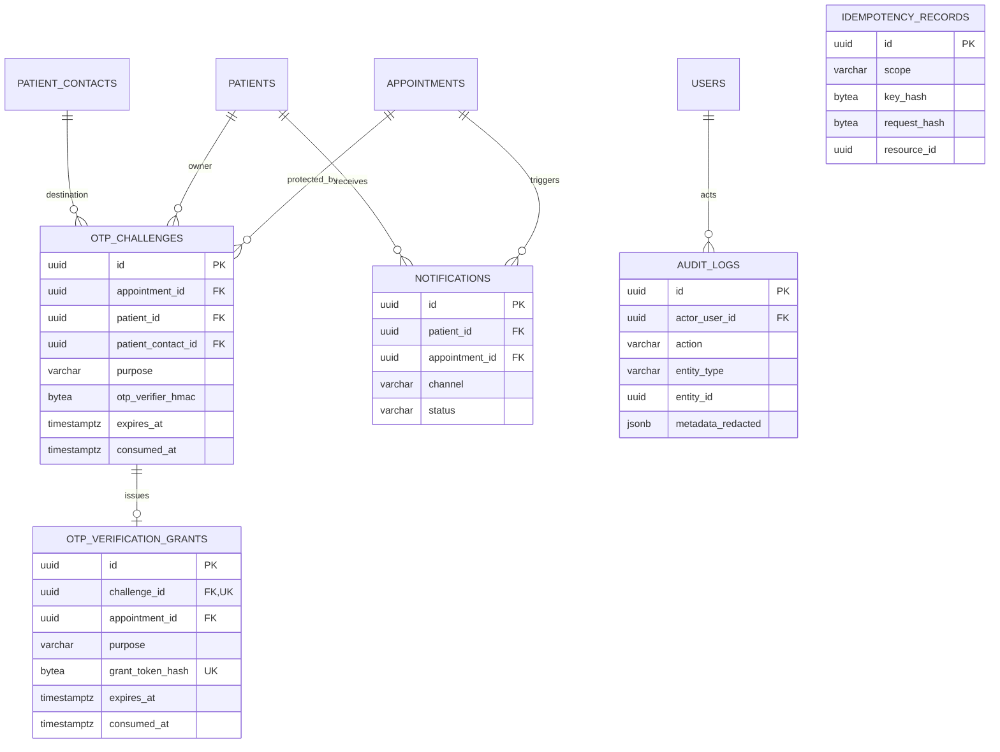

# ENTITY RELATIONSHIP DIAGRAM (ERD)

- **Version:** 1.2 — Logical ERD draft with cross-table scope constraints
- **Nguồn:** `docs/DATABASE_DESIGN.md`
- **Lưu ý:** Các sơ đồ tách theo domain để dễ đọc. Sơ đồ Mermaid hiển thị được trên GitHub; file PlantUML trong `diagrams/plantuml/` có thể chỉnh sửa.

## 0. ERD images

- [ERD 01 — Identity & Access](../diagrams/ERD_01_IDENTITY.png)
- [ERD 02 — Catalog & Scheduling](../diagrams/ERD_02_CATALOG_SCHEDULING.png)
- [ERD 03 — Appointments & Finance](../diagrams/ERD_03_APPOINTMENTS_FINANCE.png)
- [ERD 04 — OTP & Operations](../diagrams/ERD_04_OTP_OPERATIONS.png)
- [ERD Overview](../diagrams/ERD_OVERVIEW.png)

## 1. Identity & Access

## 2. Catalog & Scheduling

## 3. Appointment, Reschedule, Cancellation & Finance

## 4. OTP, Notifications, Audit & Idempotency

Lưu ý: OTP challenge có `patient_id` để composite FK buộc `appointment_id` và `patient_contact_id` thuộc cùng một Patient. OTP grant có composite FK tới đúng challenge + booking + purpose. Đây là ràng buộc vật lý bổ sung cho các quan hệ logic bên dưới.

## 5. Relationship rules to verify

1. `Patients.UserId` nullable and UNIQUE: guest-created Patient không cần User.
2. `Appointments` luôn có Patient, Doctor, Service và booking contact.
3. `Appointments` không lưu raw CCCD/BHYT/PID/OTP.
4. Một Appointment tối đa một Consultation và một Cancellation.
5. Một Appointment có thể có nhiều RescheduleRequest nhưng tối đa một request PendingReview.
6. Reschedule request không giữ proposed slot trước khi Receptionist approve.
7. PostgreSQL exclusion constraint kiểm soát overlap giữa appointment đang giữ slot.
8. Một Appointment có thể có nhiều Payment và Refund; không hoàn vượt số đã thanh toán thành công.
9. OTP grant luôn scope theo Appointment và purpose, không thay thế User authentication.
10. Merge Patient phải giữ nguồn gốc, audit và liên kết lịch sử.
